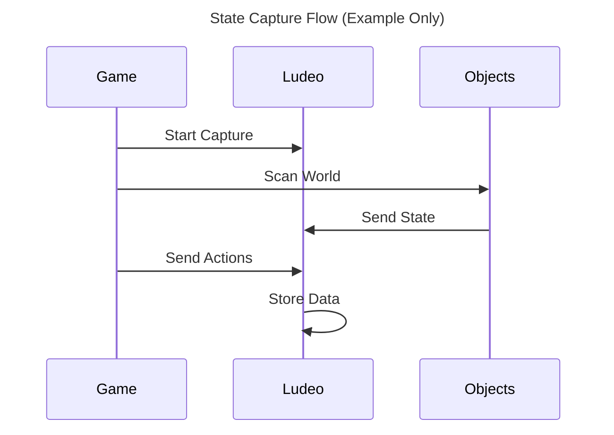
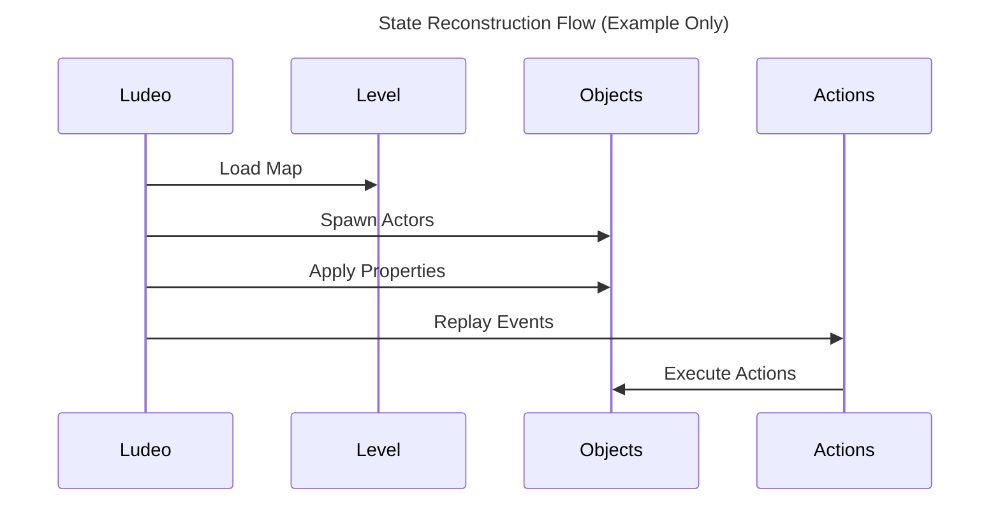
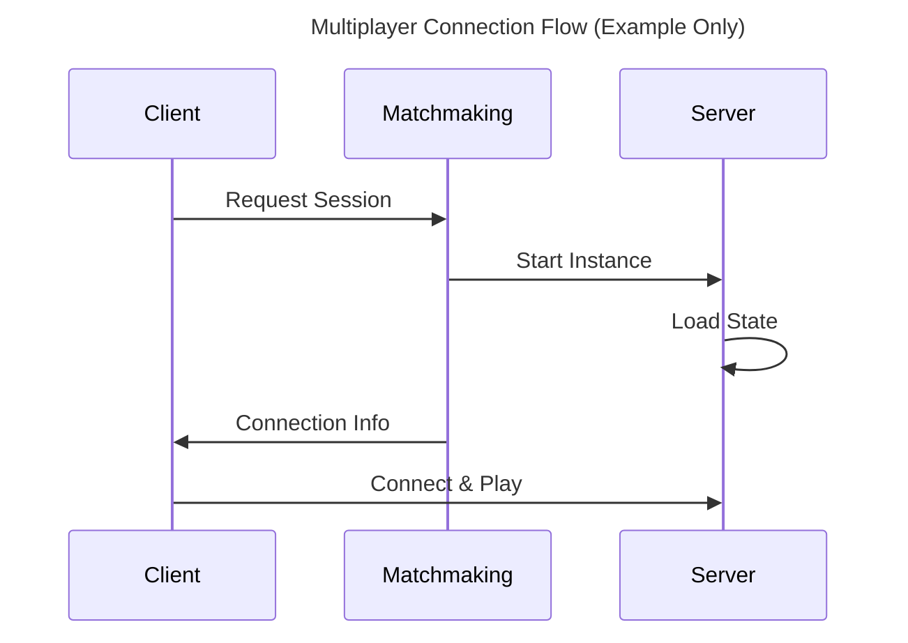

# [Game Name] x Ludeo Technical Design Document

## Abstract

<!--

DESCRIPTION: Brief overview of the integration approach and document scope

EXAMPLE: "This TDD defines the integration strategy for [Game Name] with Ludeo's capture platform, focusing on network-replicated property capture and cloud-based reconstruction for seamless replay experiences."

-->

## Game Overview

<!--

DESCRIPTION: Essential game information that affects integration complexity and approach

-->

### Studio

### Engine

<!-- EXAMPLE: "In-house C++ engine, CMake build, custom ECS" -->

### Game Modes

<!-- EXAMPLE: "single player / local co-op / online" -->

### Graphics API

<!-- EXAMPLE: "DirectX 12", "DirectX 11", "Vulkan", "OpenGL" -->

### 3rd Parties

<!-- EXAMPLE: "AccelByte (Backend services), Gameface (UI)" -->

## Integration Key Concepts

<!--

DESCRIPTION: Fundamental technical approaches and architectural decisions for the integration

EXAMPLE:

- Captures network-replicated properties at 20Hz during gameplay on the server only

- Using save system xml exporter to iterate over the scene graph and capture each object

- Reconsturct the level by loading the map, and modify its entities according to the rest of the ludeo state

-->

## State Capture Solution

<!--

DESCRIPTION: Define how game state is captured, stored, and managed during gameplay

EXAMPLE: Event-driven object detection, property comparison for updates, absence detection for destruction

-->

*(Example Only)*

### Object Lifecycle Management

<!--

DESCRIPTION: How game objects are tracked during their lifecycle (creation, updates, destruction)

EXAMPLE:

- Created: Hook into PostActorCreated events for immediate detection

- Updated: Delta detection using property comparison between capture ticks

- Destroyed: Absence detection when objects missing from FActorIterator scans

-->

### Non-Ludeoable Areas

<!--

DESCRIPTION: Segments that should never become a Ludeo — every span where live gameplay is paused, suspended or disabled while a UI screen is open (06 §7.3: death/respawn, scoreboard, results, countdown, pause and in-game menus, loading, cutscenes, spectate), plus shops, NPC dialogue, tutorials, safe zones. NOT a capture concern — tracking runs through them. They are marked by the standard StartNoneLudeable/StopNoneLudeable actions, connected to a Non-Ludeoable Area Global Trigger. List the enter/exit hooks here so phase 6 can emit the actions. See 06 §7.3.

EXAMPLE: Death screen open → StartNoneLudeable, respawn (every path) → StopNoneLudeable; pause menu open → PauseLudeo + nested StartNoneLudeable, close → StopNoneLudeable + ResumeLudeo; shop open → StartNoneLudeable, shop close (every path) → StopNoneLudeable

-->

### Actions Capture

<!--

DESCRIPTION: How player and system actions are captured and attributed during gameplay

EXAMPLE: Delegate-based system captures player inputs, system events, and AI decisions with timestamp and PlayerID attribution for accurate reconstruction

-->

## State Reconstruction Solution

<!--

DESCRIPTION: Define how captured state is restored and reconstructed for replay

EXAMPLE: Load level from metadata, spawn actors from class information, apply properties, resolve dependencies, replay actions

-->

*(Example Only)*

### Object Recreation Process

<!--

DESCRIPTION: Step-by-step process for recreating game objects from captured state data

EXAMPLE:

- Object Instantiation: Resolve class names and spawn actors with transforms

- State Application: Set replicated properties and trigger RepNotify functions

- Dependency Resolution: Two-pass system to handle circular dependencies

-->

## Cloud Specifications

<!--

DESCRIPTION: Cloud configuration for Ludeo player flow

-->

### Game Mode

<!-- EXAMPLE: Solo Mode (offline) -->

### Settings

<!-- EXAMPLE: Resolution 1920x1080 (fixed), VSync disabled -->

### NPCs

<!-- EXAMPLE: AI difficulty adjusted / NPC needs further development for better aiming -->

### Shaders

<!-- EXAMPLE: PSO caching enabled to avoid 5-15 minute compilation -->

### Game Start

<!-- EXAMPLE: Skip EULA, skip main menu, anonymous authentication / login -->

## Multiplayer Specifications

<!--

DESCRIPTION: Multiplayer architecture and cloud deployment requirements for server-based games

EXAMPLE: Linux containers, 2GB RAM requirement, auto-scaling support, dedicated server architecture

-->

### Client-Server connection flow

*(Example Only)*

## Risks & Open Questions

<!--

DESCRIPTION: Potential technical challenges, unresolved issues, dependencies, and functional requirements

-->

### Technical Risks

<!-- EXAMPLE: Performance impact on gameplay FPS, memory usage with large object counts -->

### Open Questions

<!-- EXAMPLE: Anonymous authentication for cloud sessions, procedural content capture methods -->

### Dependencies

<!-- EXAMPLE: Ludeo SDK feature completeness, cloud infrastructure availability -->

### Functional Requirements

<!-- EXAMPLE: Support dynamic arrays attributes by the Ludeo SDK -->
