# SDK Integration Process - Product Manager Guide

> **Purpose:** Brief visual guide to SDK integration workflow  
> **Audience:** Product Managers, Stakeholders  
> **Last Updated:** December 29, 2025

---

## 📊 Overview

The Ludeo SDK integration enables games to create **playable moments** - captured gameplay states that can be shared and replayed by other players.

---

## 🎯 What Gets Delivered

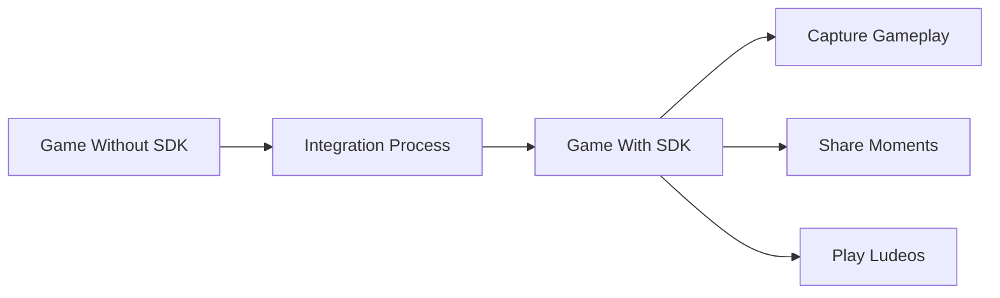

**Result:** Players can:
- ✅ Capture exciting gameplay moments
- ✅ Share them with others  
- ✅ Play back captured moments
- ✅ Complete challenges & score objectives

---

## ⏱️ Timeline Overview

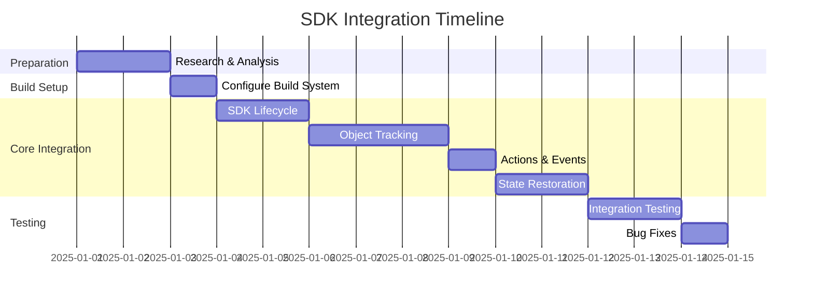

**Total Estimated Time:** 12-14 working days for typical game

---

## 📋 Phase Breakdown

### Phase 0: Research & Analysis (2 days)

**What Happens:**
- Analyze game architecture
- Document all game objects
- Identify integration points
- Map gameplay events

**Deliverable:** Complete game analysis document

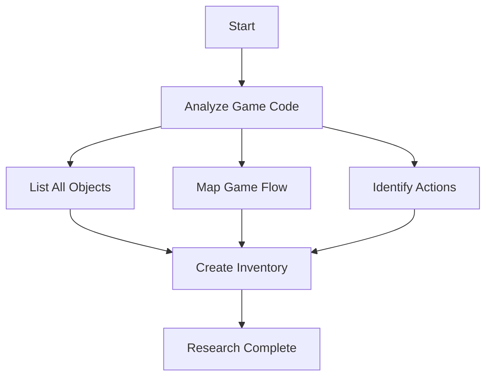

---

### Phase 1: Build Setup (1 day)

**What Happens:**
- Add SDK files to project
- Configure build system
- Create configuration headers
- Test compilation

**Deliverable:** Project builds with/without SDK

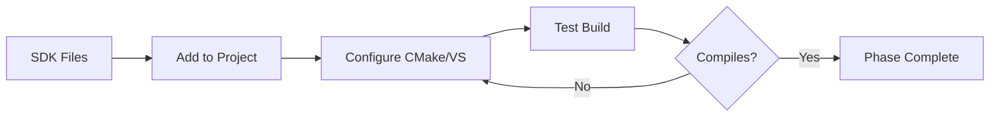

---

### Phase 2: SDK Lifecycle (2 days)

**What Happens:**
- Initialize SDK on game start
- Activate game session
- Manage gameplay sessions
- Handle SDK callbacks

**Deliverable:** SDK fully integrated into game lifecycle

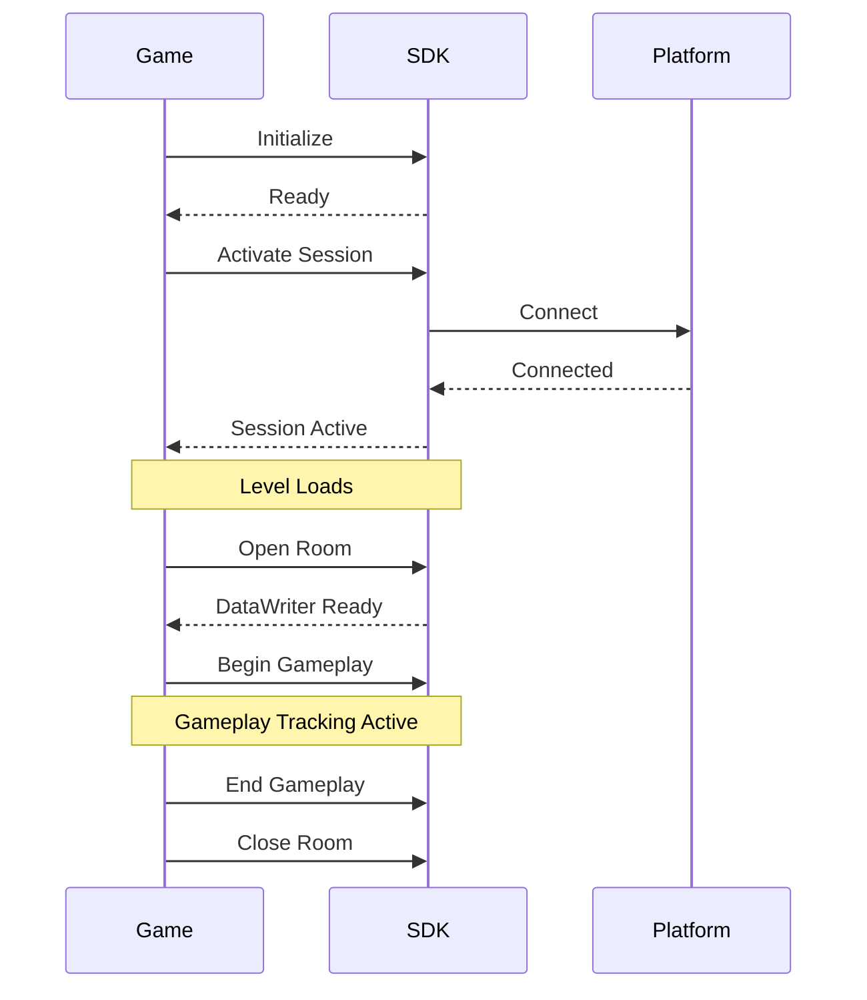

---

### Phase 3: Object Tracking (3 days)

**What Happens:**
- Add tracking to all game objects
- Capture state changes
- Track environment data
- Record gameplay actions

**Deliverable:** All game state captured during play

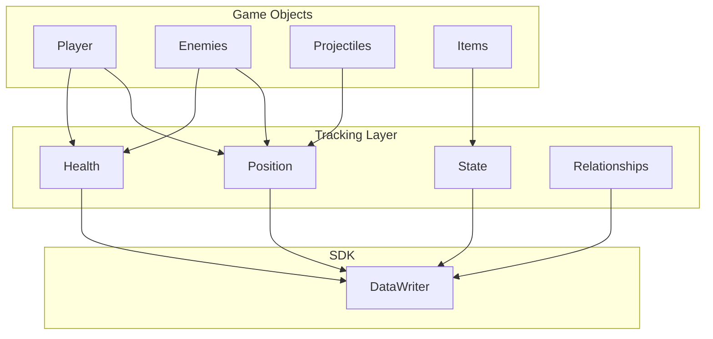

**Objects Tracked:**
- Player state (position, health, inventory)
- Enemies (AI state, behavior)
- Projectiles (trajectory, owner)
- Items (location, availability)
- Environment (camera, level data)

---

### Phase 4: Actions & Events (1 day)

**What Happens:**
- Identify gameplay events
- Add action tracking
- Enable objectives
- Configure scoring

**Deliverable:** Discrete events tracked for challenges

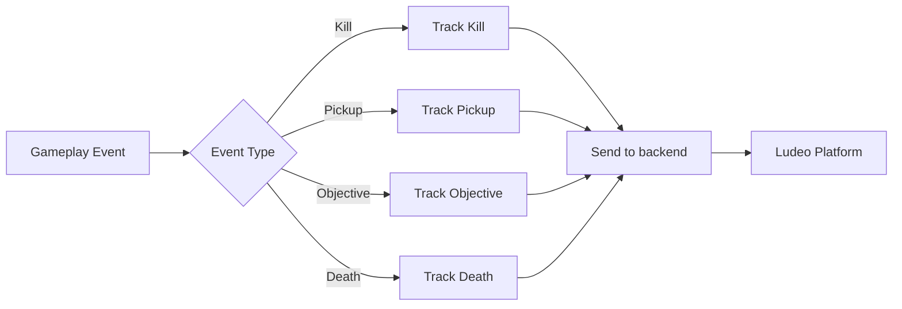

**Common Actions:**
- Combat: Kills, Deaths, Damage
- Collection: Pickups, Items, Coins
- Progression: Objectives, Unlocks
- Movement: Jumps, Dashes, Special moves

---

### Phase 5: State Restoration (2 days)

**What Happens:**
- Handle Ludeo selection
- Recreate game state
- Restore all objects
- Enable playback

**Deliverable:** Users can play captured moments

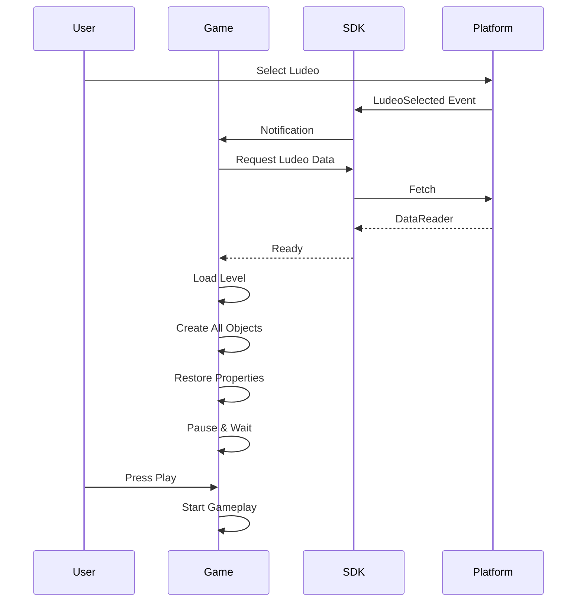

---

### Phase 6: Testing & Validation (3 days)

**What Happens:**
- Test all features
- Verify tracking accuracy
- Test restoration
- Fix issues

**Deliverable:** Fully tested, stable integration

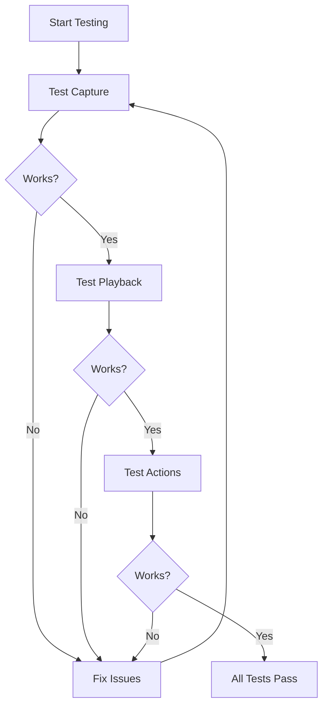

---

## 🔄 Complete Integration Flow

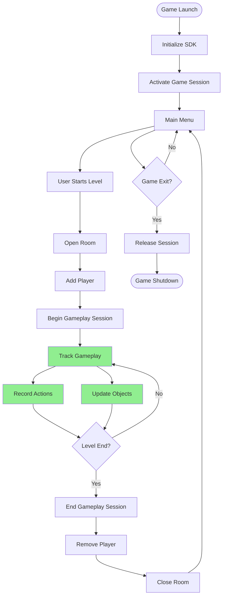

---

## 📊 Work Distribution

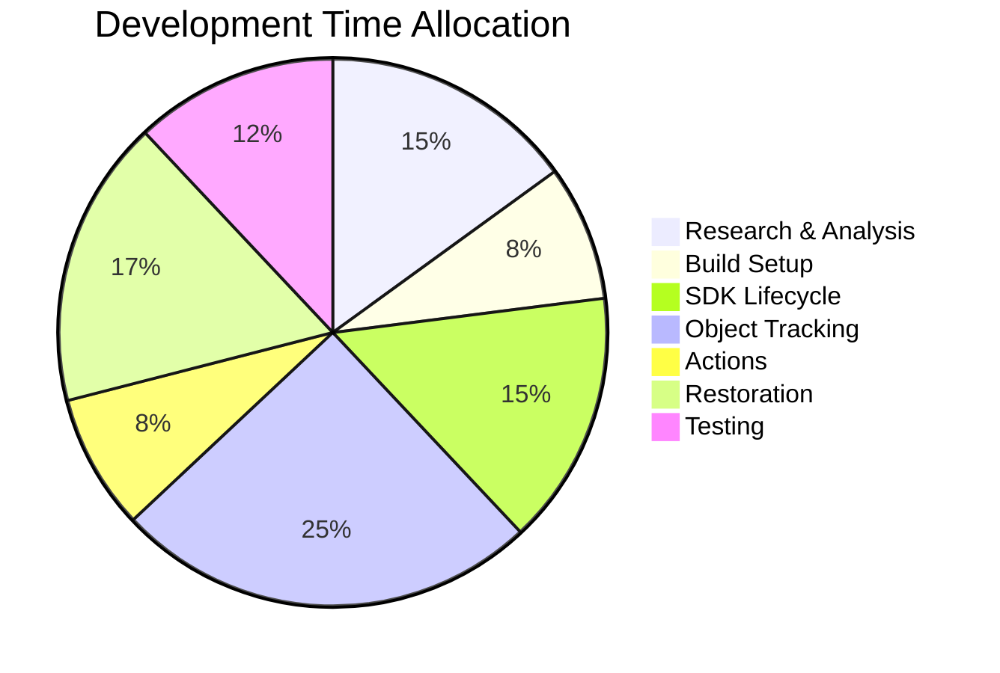

---

## 🎯 Key Milestones

### Milestone 1: Build Configuration ✓
- Project compiles with SDK
- No build errors
- DLLs copy correctly

### Milestone 2: SDK Active ✓
- SDK initializes
- Game session activates
- Callbacks work

### Milestone 3: Tracking Active ✓
- Objects register
- State updates capture
- Actions fire

### Milestone 4: Playback Works ✓
- Ludeos can be selected
- State restores correctly
- Challenges work

### Milestone 5: Production Ready ✓
- All tests pass
- Performance acceptable
- No crashes

---

## 📈 Progress Tracking

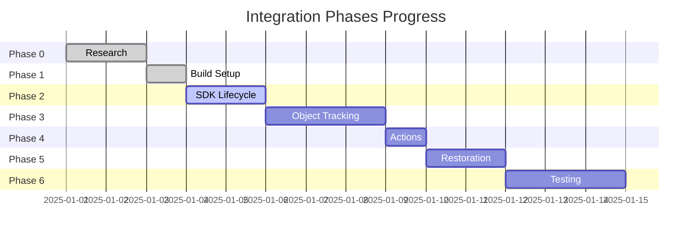

---

## 🔍 Technical Components

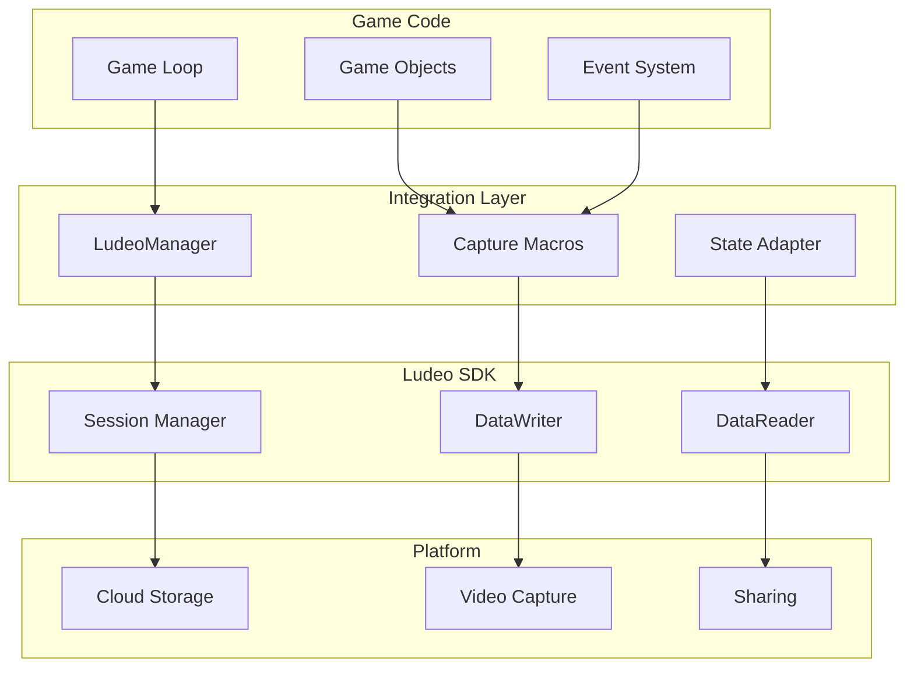

---

## 💡 Key Features Enabled

### 1. Capture
- Automatic state tracking
- No player action needed
- Continuous background capture

### 2. Share
- Upload to Ludeo Platform
- Social sharing
- Leaderboards

### 3. Playback
- One-click to play
- Exact state recreation
- Challenge friends

### 4. Objectives
- Custom challenges ("Get 5 kills")
- Scoring systems
- Competitive play

---

## ✅ Quality Gates

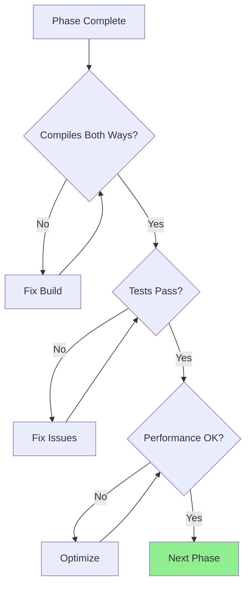

**Each phase requires:**
- ✅ Code compiles with SDK enabled
- ✅ Code compiles with SDK disabled  
- ✅ All tests pass
- ✅ No crashes or errors
- ✅ Performance within budget

---

## 📊 Risk Assessment

| Risk | Likelihood | Impact | Mitigation |
|------|-----------|--------|------------|
| Complex game architecture | Medium | High | Extra research time |
| Performance overhead | Low | Medium | Profile & optimize |
| Threading issues | Low | High | Queue operations |
| Incomplete tracking | Medium | High | Thorough object analysis |
| Restoration bugs | Medium | High | Two-pass approach |

---

## 🎓 Success Criteria

**Integration is complete when:**

1. ✅ **Build System**
   - Compiles with SDK enabled
   - Compiles with SDK disabled
   - No build warnings

2. ✅ **Functionality**
   - Players can capture moments
   - Players can share Ludeos
   - Players can play Ludeos
   - Actions work for objectives

3. ✅ **Quality**
   - No crashes
   - Performance acceptable
   - Error handling works
   - Graceful degradation

4. ✅ **Testing**
   - All test checklists pass
   - Edge cases handled
   - Multi-platform tested

---

## 🔄 Integration Architecture

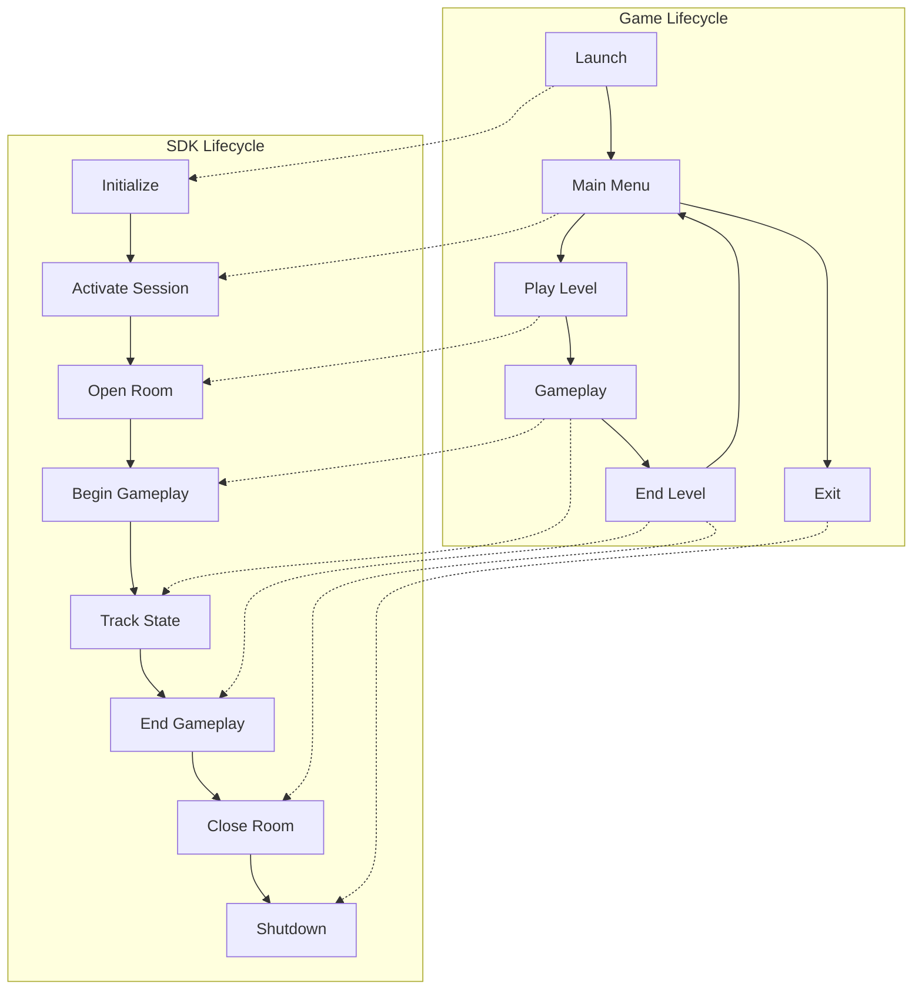

---

## 📞 Support & Questions

**For technical details:** See full integration documentation  
**For timeline questions:** Refer to Gantt charts above  
**For scope questions:** Review phase breakdown sections

---

## 📝 Summary

**What:** Integrate Ludeo SDK to enable playable moment capture/sharing  
**When:** 12-14 working days typical timeline  
**How:** 6 phases from research to testing  
**Why:** Enable new social gameplay features  

**Bottom Line:** Structured process with clear milestones, visual progress tracking, and quality gates at each phase.

---

*This document provides a high-level overview. Technical implementation details are in the full integration documentation.*

